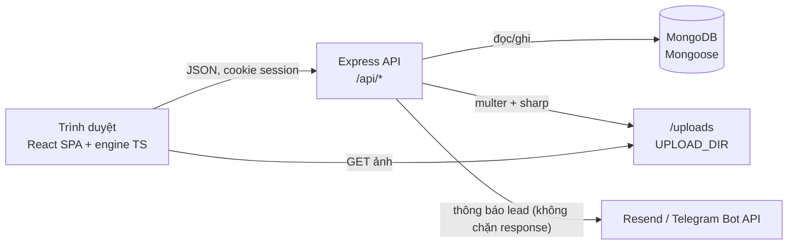
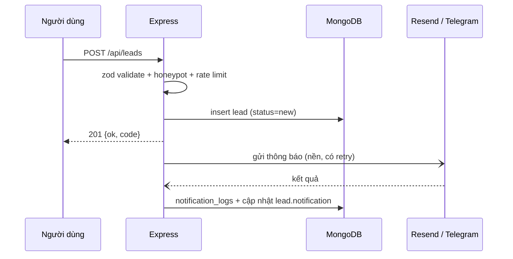

# Kế hoạch triển khai feedback khách hàng — Web TSH Hướng Nghiệp (SGEN Education)

Nguồn feedback: `Nội Dung Web TSH Hướng Nghiệp_Sgen Education.pdf` (2 trang).
Đối chiếu hiện trạng: commit `1a1621e`, ngày 12/09/2026.
Ràng buộc bắt buộc: `AGENTS.md` (MongoDB CMS, uploads, admin auth/UX, notification rule, data rule).

---

## 0. Tóm tắt điều hành

Feedback gồm hai khối:

1. **Giao diện**: ô tra cứu phải nền trắng để trang không bị tối/mỏi mắt; tham chiếu 3 site (`tracuuthansohoc.com`, `xemngay.thayphongthuy.vn`, `simkinhdich.com/sim-phong-thuy`).
2. **Cấu trúc website**: 9 menu cấp 1 với các module chức năng mới (tra cứu DISC/MBTI, phần mềm bói sim, mua VIP/trọn đời, 11 khóa học, free tools, blog, đăng nhập).

Hiện trạng là landing page tĩnh: **không có backend, không có DB, không có CMS, không có auth**, toàn bộ nội dung hardcode trong TypeScript, mọi form xử lý client-side và không gửi đi đâu. Vì vậy kế hoạch không thể chỉ là "thêm trang": phải dựng hạ tầng CMS MongoDB trước (AGENTS.md), rồi đưa 9 module lên trên đó.

Thứ tự thi công: **P0 hạ tầng CMS → P1 IA/route → P2 sửa giao diện ô tra cứu → P3 đưa nội dung vào DB → P4–P8 module chức năng → P9 SEO/QA**. P2 là việc nhỏ, độc lập, có thể phát hành ngay trong tuần đầu để khách thấy tiến độ.

---

## 1. Feedback đã chuẩn hoá thành hạng mục kỹ thuật

| # | Nguyên văn feedback | Diễn giải kỹ thuật | Hạng mục |
| --- | --- | --- | --- |
| I | "Các ô tra cứu cho nền màu trắng…" + 3 site tham chiếu | Đổi toàn bộ field nhập liệu sang nền trắng, chữ đậm; nền section có thể giữ tối, field không tối | `UI-field` |
| II.1 | GIỚI THIỆU: Tầm nhìn / Sứ mệnh / Giá trị cốt lõi / Liên hệ | 4 trang nội dung riêng + menu con | `MOD-about` |
| II.2 | TRA CỨU THẦN SỐ HỌC: thần số học / DISC / MBTI | 1 hub + 3 công cụ tra cứu; DISC và MBTI chưa tồn tại | `MOD-lookup` |
| II.3 | DỊCH VỤ: mua VIP thần số học / trọn đời / định hướng nghề nghiệp | Gói dịch vụ có giá, đơn hàng, quyền truy cập (entitlement) → cần tài khoản + thanh toán | `MOD-service` |
| II.4 | PHONG THỦY SIM SỐ ĐIỆN THOẠI: phần mềm bói sim | Engine luận sim mới + trang công cụ | `MOD-sim` |
| II.5 | CÔNG CỤ PHONG THỦY: Gieo Quẻ Kinh Dịch / Tứ Trụ Bát Tự / Xem ngày | 3 công cụ đã có engine, cần tách thành route công khai | `MOD-fs` |
| II.6 | KHÓA HỌC: 11 nhóm khóa học liệt kê | 11 khóa học, mỗi khóa một trang chi tiết (bỏ modal) | `MOD-course` |
| II.7 | FREE TOOLS: trình bày như `tracuuthansohoc.com` | Hub công cụ dạng accordion/danh sách, mỗi công cụ là trang thật | `MOD-free` |
| II.8 | BLOG: trình bày như `tracuuthansohoc.com/kien-thuc` | Blog có chuyên mục, trang chuyên mục, sidebar bài liên quan | `MOD-blog` |
| II.9 | ĐĂNG NHẬP | Đăng nhập thành viên + khu vực tài khoản; admin tách riêng `/admin` | `MOD-auth` |
| — | AGENTS.md | CMS MongoDB, uploads, admin auth/UX, notification, seed data | `CMS` |

---

## 2. Hiện trạng đã kiểm chứng

### 2.1 Hạ tầng

| Hạng mục | Thực tế | Bằng chứng |
| --- | --- | --- |
| Backend/API | Không có | `package.json` chỉ 4 dependency runtime; không có thư mục `server/`; không có `.env*` |
| Điều hướng | Router tự viết bằng `history.pushState` + click delegation, không có 404 | `src/App.tsx:45-68`; đường dẫn lạ render `HomePage` (`src/App.tsx:84-85`) |
| Route công khai | 7: `/`, `/gioi-thieu`, `/tra-cuu`, `/dich-vu`, `/khoa-hoc`, `/free-tools`, `/blog`, `/blog/:slug` | `src/App.tsx:69-85`, `src/pages/SitePages.tsx:276-282` |
| Meta/SEO | Chỉ 1 bộ meta tĩnh; title đổi theo route bằng tay | `index.html:4-9`, `src/App.tsx:70-82` |
| CSS không dùng | `.login-*`, `.newsletter` (không component nào tham chiếu) | `src/styles/pages.css:435-459`, `:431-433` |

### 2.2 Nội dung (đều hardcode, chưa có DB)

| Nội dung | Số lượng | Vị trí |
| --- | --- | --- |
| Khóa học | 6 (feedback yêu cầu 11) | `src/pages/SitePages.tsx:207-214`; chi tiết mở bằng modal `:234` |
| Bài blog | 6 bài / 4 ảnh | `src/data/blog.ts:19,33,47,61,75,89` |
| Dịch vụ | 6 card mô tả, không có giá/gói | `src/pages/SitePages.tsx:182-189` |
| Công cụ nhóm "miễn phí" | 4 card, tất cả trỏ về `/tra-cuu` chung, không có tool riêng | `src/components/sections/ToolsSection.tsx:43-48,110` |
| Form gửi lead | Không nơi nào gửi; submit chỉ `setSent(true)` | `src/components/sections/ConsultationSection.tsx:41-43`; không có `fetch(` trong `src/` |

### 2.3 Engine đã có (tài sản lớn, tái sử dụng)

| Engine | Nội dung | Bằng chứng |
| --- | --- | --- |
| Thần số học | 8 chỉ số: `lifePath, destiny, soul, attitude, personalYear, peaks, interaction, maturity` | `src/lib/numerology.ts:16-25`, hàm tính `:165` |
| Mệnh lý | 34 khai báo export (23 hàm): âm lịch, tứ trụ, thập thần, nạp âm, trường sinh, đại vận, hồ sơ ngày, quan sát người Việt, tiết khí, quẻ dịch, Hà Lạc | `src/lib/menh-thu/metaphysics.ts` |
| Dữ liệu tham chiếu | Bảng năng lượng ngày **1096 ngày = 01/01/2026 → 31/12/2028**; fixture khớp chính xác tháng 08/2026 | `src/lib/menh-thu/reference-day-energy.generated.ts:5-16`, `reference-august-2026.generated.ts` |
| 3 công cụ phong thủy | Gieo quẻ (3 đồng xu) `:121`, Tứ trụ (4 trụ + đại vận) `:228`, Xem ngày (năng lượng ngày, 12 giờ, đối chiếu tuổi) `:327` | `src/components/sections/FengShuiTools.tsx:42-404` |

Ngoài khoảng tham chiếu, `getDateProfile` tự tính bằng bộ luật chung (`src/lib/menh-thu/metaphysics.ts:1490-1560`), nên Xem ngày vẫn chạy cho mọi ngày — chỉ mất điểm năng lượng đúng bằng dữ liệu tham chiếu sau 31/12/2028.

### 2.4 Giao diện ô nhập liệu hiện tại (đối tượng của feedback I)

| Bề mặt | Field hiện tại | Bằng chứng |
| --- | --- | --- |
| Hero, form tra cứu | nền `rgba(255,255,255,.055)`, chữ trắng, `color-scheme: dark` | `src/styles/hero.css:319-359` |
| `/tra-cuu`, form phân tích | input trong suốt trên card tối, chữ trắng | `src/styles/pages.css:218-221` |
| Công cụ phong thủy | input `#18111f`, chữ `#f5f0f7` | `src/styles/fengshui-tools.css:1442-1456` |
| Form tư vấn (nền sáng) | gạch chân, không có nền field | `src/styles/final.css:214-224` |
| Toolbar khóa học / blog | input trần, không viền | `src/styles/pages.css:268,365` |

3 trên 5 bề mặt đang là field tối → đúng vấn đề khách phản ánh.

---

## 3. Quyết định kiến trúc

| ID | Quyết định | Lý do / đánh đổi |
| --- | --- | --- |
| D1 | Dùng `react-router` v7, thay router tự viết | Cần route lồng nhau (9 menu + admin + member), `:slug`, 404, scroll restore. Router hiện tại không làm được, và click-delegation đang phải tự chặn modifier click |
| D2 | Backend Node 22 + Express + Mongoose trong `server/`, cùng repo | AGENTS.md bắt buộc MongoDB và `/uploads`; Vite dev proxy `/api` + `/uploads`, production Express phục vụ `dist/` + `/uploads` + SPA fallback |
| D3 | Auth 2 vùng tách biệt: admin (`admin_sid`) và member (`member_sid`), session cookie httpOnly + `connect-mongo` | AGENTS.md yêu cầu khoá admin; member chỉ cần cho VIP/lịch sử tra cứu. Tách cookie để logout member không ảnh hưởng phiên admin |
| D4 | Engine là module TS thuần dùng chung cho cả client và server | Công cụ miễn phí tính tại trình duyệt (giữ đúng lời hứa "không gửi dữ liệu đi" ở `src/pages/SitePages.tsx:166`); báo cáo trả phí tính ở server để chống sửa kết quả và gắn với entitlement |
| D5 | Nội dung công khai có **fallback trong repo** (`src/data/defaults/*`), API lỗi vẫn render | AGENTS.md: "Public LDP needs safe fallback if CMS data is missing" |
| D6 | Upload bằng `multer` vào `UPLOAD_DIR`, `sharp` sinh 3 cỡ + webp, Mongo chỉ lưu `/uploads/...` | Đúng AGENTS.md, tránh base64 trong DB |
| D7 | Secrets notification mã hoá AES-256-GCM, khoá từ env `SETTINGS_ENC_KEY`; đọc/ghi qua Site Settings | AGENTS.md: cấu hình trong CMS, không trả full value ra client. Khoá mã hoá là hạ tầng, không phải giá trị cấu hình |
| D8 | Idempotent seed `npm run seed` + `npm run create-admin` | AGENTS.md: CMS không được rỗng sau setup, seed an toàn cho dev/staging, không hardcode credential |
| D9 | Prerender route công khai ở bước build (P9) | Site tham chiếu sống bằng SEO; SPA thuần mất nội dung khi crawler không chạy JS. Admin/member `noindex` |
| D10 | Thêm `@tanstack/react-query`, `react-hook-form` + `zod` | Admin có ~12 module CRUD; tự viết cache/validation sẽ phình code và lệch chuẩn UX (loading/error/disabled/toast) mà AGENTS.md yêu cầu |
| D11 | Thanh toán v1: chuyển khoản + VietQR + admin xác nhận, sau interface `PaymentProvider` | Không phụ thuộc hợp đồng cổng thanh toán; VNPay/MoMo cắm sau mà không đổi model |
| D12 | DISС/MBTI: tự soạn bộ câu hỏi tiếng Việt, ghi rõ "tham chiếu khung", không sao chép đề gốc | MBTI là thương hiệu đã đăng ký; dùng nguyên văn đề thi của bên thứ ba là rủi ro pháp lý |

---

## 4. Kiến trúc đích



Cấu trúc thư mục đích:

```
server/
  src/index.ts            # bootstrap, static dist, SPA fallback
  src/app.ts              # middleware chain: helmet, session, csrf, routes
  src/db.ts               # kết nối Mongoose
  src/models/*.ts         # 1 file / collection
  src/routes/public/*.ts  # nội dung, tra cứu, lead, member, order
  src/routes/admin/*.ts   # CRUD + settings + test notification
  src/middleware/*.ts     # auth, role, csrf, rate-limit, validate(zod), error
  src/services/*.ts       # notifications, media, entitlements, order, seed
src/
  app/router.tsx          # route tree (react-router)
  layouts/                # PublicLayout, MemberLayout, AdminLayout
  api/client.ts           # fetch typed + react-query hooks
  components/form/        # Field, FormCard, StickyActionBar, ConfirmDialog, Toast
  components/admin/       # DataTable, FilterPopover, StatusBadge, MediaPicker
  data/defaults/*         # nội dung fallback khi API lỗi
  lib/sim/*               # engine luận sim
  lib/lookups/*           # engine DISC/MBTI, luận giải theo chỉ số
```

---

## 5. Bản đồ route đích

| Menu cấp 1 | Route | Nội dung | Phase |
| --- | --- | --- | --- |
| **Giới thiệu** | `/gioi-thieu` | Hub giới thiệu | P1 |
| | `/gioi-thieu/tam-nhin` | Tầm nhìn | P3 |
| | `/gioi-thieu/su-menh` | Sứ mệnh | P3 |
| | `/gioi-thieu/gia-tri-cot-loi` | Giá trị cốt lõi | P3 |
| | `/lien-he` | Liên hệ + form + bản đồ | P3 |
| **Tra cứu Thần số học** | `/tra-cuu` | Hub chọn loại hình tra cứu | P1 |
| | `/tra-cuu/than-so-hoc` | Tra cứu 8 chỉ số (đã có engine) | P4 |
| | `/tra-cuu/disc` | Trắc nghiệm DISC | P4 |
| | `/tra-cuu/mbti` | Trắc nghiệm MBTI | P4 |
| | `/tra-cuu/ket-qua/:id` | Xem lại kết quả (token hoặc member) | P4 |
| **Dịch vụ** | `/dich-vu` | Danh sách gói | P7 |
| | `/dich-vu/:slug` | Chi tiết gói (mua VIP, trọn đời, định hướng nghề nghiệp) | P7 |
| | `/dich-vu/don-hang/:code` | Trạng thái đơn + hướng dẫn chuyển khoản | P7 |
| **Phong thủy sim** | `/sim-phong-thuy` | Giới thiệu phương pháp | P5 |
| | `/sim-phong-thuy/boi-sim` | Phần mềm bói sim | P5 |
| **Công cụ phong thủy** | `/cong-cu-phong-thuy` | Hub 3 công cụ | P1 |
| | `/cong-cu-phong-thuy/gieo-que-kinh-dich` | Gieo quẻ | P5 |
| | `/cong-cu-phong-thuy/tu-tru-bat-tu` | Lập lá số tứ trụ | P5 |
| | `/cong-cu-phong-thuy/xem-ngay` | Xem ngày tốt/xấu + lịch tháng + in | P5 |
| **Khóa học** | `/khoa-hoc` | Danh sách 11 khóa (search/sort/filter/paginate, URL state) | P6 |
| | `/khoa-hoc/:slug` | Chi tiết khóa (route riêng, bỏ modal) | P6 |
| **Free tools** | `/free-tools` | Hub công cụ theo trình bày tham chiếu | P4 |
| | `/free-tools/:slug` | Trang công cụ lẻ (chỉ số, mũi tên, biểu đồ ngày sinh, xem tên…) | P4 |
| **Blog** | `/blog` | Danh sách + chuyên mục | P3 |
| | `/blog/kien-thuc` | Trang kiến thức theo tham chiếu | P3 |
| | `/blog/:slug` | Bài viết (đã có) | P3 |
| **Đăng nhập** | `/dang-nhap`, `/dang-ky`, `/quen-mat-khau` | Member auth | P8 |
| | `/tai-khoan` | Hồ sơ, lịch sử tra cứu, đơn hàng, quyền VIP | P8 |
| — | `/admin/*` | CMS (noindex, không vào menu công khai) | P0–P7 |
| — | `*` | Trang 404 | P1 |

Chuyển hướng giữ tương thích: `/tra-cuu?metric=lifePath` (đang được `ToolsSection` phát ra, `src/components/sections/ToolsSection.tsx:110`) → `/free-tools/:slug` tương ứng; `/#tu-van` giữ nguyên vì `ConsultationSection` có `id="tu-van"` (`src/components/sections/ConsultationSection.tsx:48`).

---

## 6. Data model (MongoDB / Mongoose)

| Collection | Field chính | Index |
| --- | --- | --- |
| `users` (admin/editor) | email, name, passwordHash (bcrypt), role `admin\|editor`, status, lastLoginAt | unique `{email}` |
| `members` | email, name, passwordHash, phone, birthDate, verifyToken, status | unique `{email}` |
| `sessions` | connect-mongo store | TTL |
| `site_settings` (1 doc) | brand, contact{phone,email,address,mapEmbed}, socials, seoDefaults, notification{providers, encSecrets, enabled, template}, featureFlags | singleton key |
| `pages` | slug, title, seo, blocks[{type, props, order}], status | unique `{slug}` |
| `sections` | key, name, type, data, order, visible | unique `{key}` |
| `courses` | slug, title, coverImage, level, duration, sessions, mode, price, teacher, summary, syllabus[], outcomes[], forWhom[], faqs[], categoryId, order, status, seo | unique `{slug}`, `{status, order}` |
| `course_categories` | slug, name, order | unique `{slug}` |
| `posts` | slug, title, cover, categoryId, tags[], excerpt, content{blocks}, authorId, readMinutes, publishedAt, status, seo | unique `{slug}`, `{status, publishedAt}` |
| `post_categories` | slug, name, order | unique `{slug}` |
| `services` | slug, name, price, priceNote, description, deliverables[], duration, isFeatured, order, status | unique `{slug}` |
| `orders` | code, memberId, serviceSlug, amount, method `bank_transfer\|vietqr`, status `pending\|paid\|cancelled\|expired`, proofImage, paidAt, adminNote | unique `{code}`, `{status, createdAt}` |
| `entitlements` | memberId, type `vip-numerology\|lifetime`, orderId, grantedAt, expiresAt, active | `{memberId, active}` |
| `lookup_reports` | type `numerology\|disc\|mbti\|sim\|batu\|iching\|xem-ngay`, inputs, result, referenceId, memberId?, leadId?, shareToken?, shareExpiresAt?, createdAt | `{type, createdAt}`, `{memberId}`, unique sparse `{shareToken}` |
| `quiz_sets` | key `disc\|mbti`, version, title, instructions, scoring{...}, status | unique `{key, version}` |
| `quiz_items` | setId, order, text, options[{label, value, dimension/weights}] | `{setId, order}` |
| `quiz_results` | setId, code (D/I/S/C hoặc 16 type), title, summary, strengths[], cautions[], careers[], growth[], sections[] | `{setId, code}` |
| `leads` | name, phone, email, birthDate, message, source (route + tool), payload (snapshot input/kết quả), status `new\|contacted\|won\|lost`, assignedTo, note, notification{resend, telegram, attempts, lastError}, createdAt | `{status, createdAt}`, text index `{name, phone, email}` |
| `media` | filename, url `/uploads/...`, mime, size, width, height, alt, folder, variants[{label,url,width}], refCount, uploadedBy | `{createdAt}`, text `{filename, alt}` |
| `notification_logs` | channel, target, payload, status, error, relatedLeadId | `{createdAt}` |
| `audit_logs` | actorId, action, collection, docId, diff, at | `{at}` |

Quy ước: giá VND lưu số nguyên; mọi ảnh lưu đường dẫn `/uploads/...` (không base64, không URL ngoài); mọi danh sách có `status` + `order` để listing CMS sắp xếp và ẩn/hiện.

---

## 7. API surface

| Nhóm | Endpoint | Ghi chú |
| --- | --- | --- |
| Công khai – nội dung | `GET /api/settings`, `GET /api/pages/:slug`, `GET /api/sections?keys=`, `GET /api/courses`, `GET /api/courses/:slug`, `GET /api/posts`, `GET /api/posts/:slug`, `GET /api/post-categories`, `GET /api/services`, `GET /api/services/:slug` | Chỉ trả status `published`; settings đã mask secret |
| Công khai – tra cứu | `POST /api/lookups/:type` (numerology, disc, mbti, sim, batu, iching, xem-ngay) | Tính lại phía server (D4), lưu `lookup_reports`, trả `referenceId` + `shareToken` nếu người dùng chọn lưu/chia sẻ |
| Công khai – quiz | `GET /api/quiz/:key` (câu hỏi, không kèm đáp án chấm điểm), `POST /api/quiz/:key/score` | Đề thi tách khỏi bảng điểm để client không đọc trước kết quả |
| Công khai – lead | `POST /api/leads` | Validate zod, honeypot + rate limit; lưu trước, gửi thông báo sau (mục 11) |
| Member | `POST /api/members/register\|login\|logout\|forgot\|reset`, `GET /api/members/me`, `GET /api/members/reports`, `GET /api/members/orders`, `POST /api/orders`, `POST /api/orders/:code/proof`, `GET /api/orders/:code` | `member_sid` cookie; member chỉ thấy dữ liệu của mình |
| Admin | `/api/admin/auth/*`, `/api/admin/{dashboard,users,members,leads,orders,entitlements,courses,course-categories,posts,post-categories,pages,sections,services,media,quiz-sets,quiz-items,quiz-results,settings,notifications}` | Bắt buộc session + role; mutation cần CSRF token; `settings` trả secret đã mask; `POST /api/admin/notifications/test` |
| Hệ thống | `GET /api/health` | Dùng cho deploy/healthcheck |

Quy tắc quyền: `editor` CRUD nội dung (khóa học, blog, media, sections, services, quiz), không truy cập `users`, `settings`, `orders`, `members`, `audit_logs`; `admin` toàn quyền. Mọi API admin đều nằm sau middleware, không có nhánh "public admin".

---

## 8. Feedback giao diện — ô tra cứu nền trắng

Chuẩn hoá thành một primitive duy nhất thay vì sửa lẻ từng màn hình:

```css
/* tokens bổ sung trong src/styles/global.css */
--field-bg: #ffffff;
--field-bg-alt: #faf7f1;   /* biến thể "nền màu đất nhạt" của simkinhdich */
--field-border: #d8d3e6;
--field-text: #1b1a35;
--field-placeholder: #6f6b85;
--field-focus: #5a22e8;
```

| Yêu cầu | Cách làm | Nghiệm thu |
| --- | --- | --- |
| Field nền trắng | `.field` dùng `--field-bg`, chữ `--field-text`, `color-scheme: light` (bắt buộc cho input `date`/`time`) | Không còn `color-scheme: dark` ở `hero.css:357-359`, `pages.css:221` |
| Không tối cả trang | Field trắng trên card tối; section danh sách/công cụ chuyển nền sáng | Bảng "nền sáng/tối" theo route được duyệt ở P2 |
| Đủ tương phản | Chữ ≥ 4.5:1, viền field ≥ 3:1 trên nền thật | Đo bằng công cụ contrast trên ảnh chụp 4 breakpoint |
| Trạng thái đầy đủ | hover / focus-visible / invalid / disabled / loading cho mọi field | Kiểm tra bằng bàn phím, không chỉ chuột |
| Nhất quán | Hero, `/tra-cuu`, 3 công cụ phong thủy, sim, login member, admin form đều dùng `.field` | Không còn CSS field trùng lặp ở 5 file |

Bề mặt phải sửa: `src/styles/hero.css:319-359`, `src/styles/pages.css:218-226,435-459`, `src/styles/fengshui-tools.css:298-330,1442-1456`, `src/styles/final.css:214-224`, `src/styles/pages.css:268,365`. Component dùng chung: `src/components/form/Field.tsx` + biến thể `FieldSelect`, `FieldDate`, `FieldSearch`.

---

## 9. Đặc tả module

### 9.1 Giới thiệu (`MOD-about`)

- 4 trang nội dung lấy từ `pages` (blocks: heading, richtext, stats, values, timeline, cta, contact-info, map).
- Trang Liên hệ: form lead `source: "lien-he"`, thông tin công ty lấy từ `site_settings.contact` (nguồn hiện tại: `Footer.tsx:22-28`), map nhúng bằng iframe cấu hình trong CMS.
- Tái sử dụng nguyên khối hiện có: `AboutPage` (`src/pages/SitePages.tsx:88-135`) tách thành block `story`, `values`, `journey`.

### 9.2 Tra cứu (`MOD-lookup`)

| Công cụ | Engine | Việc phải làm |
| --- | --- | --- |
| Thần số học | có (`numerology.ts`, 8 chỉ số) | Tách hàm tính từng chỉ số; bổ sung biểu đồ ngày sinh + mũi tên thần số học; luận giải lấy từ DB; trang kết quả có 8 thẻ chỉ số + CTA mua báo cáo đầy đủ |
| DISC | mới | Bộ đề tiếng Việt (~24–28 câu), chấm theo 4 nhóm D/I/S/C, template kết quả theo nhóm trội, lưu vào `quiz_*` |
| MBTI | mới | Bộ đề ~70 câu theo 4 cặp xu hướng, chấm theo tổng điểm mỗi cực, template 16 nhóm; ghi chú "tham chiếu khung 4 cặp xu hướng", không dùng đề gốc |

Luồng chung: chọn công cụ → nhập/khảo sát → kết quả tóm tắt miễn phí → (tuỳ chọn) lưu vào tài khoản hoặc gửi lead để nhận tư vấn → CTA báo cáo đầy đủ (P7). Kết quả miễn phí tính tại trình duyệt; khi người dùng bấm lưu/chia sẻ mới gọi API (D4) — phải sửa lại câu chữ `src/pages/SitePages.tsx:166` cho khớp hành vi mới (hiện ghi "không tự động gửi đi").

### 9.3 Dịch vụ (`MOD-service`)

- 3 gói theo feedback: **Mua VIP Thần số học** (có thời hạn), **Xem Thần số học trọn đời** (entitlement vĩnh viễn), **Định hướng nghề nghiệp phù hợp** (dịch vụ có lịch hẹn + lead).
- Luồng mua: chọn gói → tạo `order` (pending) → trang đơn hiển thị VietQR sinh từ cấu hình ngân hàng trong Site Settings + mã đơn làm nội dung chuyển khoản → member tải ảnh biên lai → admin xác nhận `paid` → cấp `entitlement`.
- Báo cáo trọn đời: nội dung luận giải đầy đủ tính ở server, chỉ trả khi `entitlement` còn hiệu lực; không có nhánh nào trả dữ liệu VIP cho khách ẩn danh.
- Trang chi tiết dịch vụ cần: mô tả, quyền lợi, giá, thời hạn, FAQ, CTA mua/đặt lịch, chính sách hoàn tiền (nội dung do khách cung cấp).

### 9.4 Phong thủy sim (`MOD-sim`)

- Engine mới `src/lib/sim/`: nhận diện nhà mạng theo đầu số; luận theo Kinh Dịch (quẻ chủ/hỗ/biến từ toàn dãy số, tái dùng `getHexagram` + `TRIGRAMS`), ngũ hành các số (Hà Đồ/Lạc Thư, kèm lưu ý số 0 không có ngũ hành chuẩn), âm dương (chẵn/lẻ), đối chiếu ngày giờ sinh (tái dùng `getFourPillars`, `getElementBalance`, `getBaziSupportProfile`).
- Kết quả: điểm tổng + 4–6 khối phân tích + phần "phương pháp đang áp dụng" để minh bạch (site tham chiếu `simkinhdich.com` dành nhiều dung lượng giải thích vì mỗi nơi luận một kiểu).
- Ngoài phạm vi (chờ khách xác nhận, xem mục 14): danh mục sim để bán, chọn sim, so sánh 2 sim, tìm sim tương tự.

### 9.5 Công cụ phong thủy (`MOD-fs`)

| Công cụ | Nền tảng có sẵn | Bổ sung |
| --- | --- | --- |
| Gieo quẻ Kinh Dịch | `IChingTool` (`FengShuiTools.tsx:121-227`) | Route riêng, lưu kết quả, in/chia sẻ, luận giải quẻ từ DB thay vì chỉ hiển thị quẻ |
| Tứ trụ Bát Tự | `BaziTool` (`:228-326`) | Route riêng, luận giải thập thần/nạp âm/đại vận theo template DB, in PDF (print CSS) |
| Xem ngày | `CalendarTool` (`:327-404`) | Route riêng, thêm lịch tháng (`getMonthCalendar`), chọn "việc cần làm" để lọc ngày tốt trong tháng, bảng 12 giờ, in trang |

### 9.6 Khóa học (`MOD-course`) — 11 khóa theo feedback

| # | Tên khóa (feedback) | Trạng thái |
| --- | --- | --- |
| 1 | Thần số học | đã có (`Thần số học căn bản`) |
| 2 | Sinh trắc vân tay | đã có |
| 3 | Phong thủy kinh dịch sim số | đã có (`Phong thủy sim số`) — cần đồng bộ tên |
| 4 | Phong thủy tình duyên và hôn nhân | đã có |
| 5 | Gieo quẻ Kinh Dịch | **mới** |
| 6 | Tú Trụ Bát Tự | **mới** |
| 7 | Huyền không phi tinh | **mới** |
| 8 | Huyền không đại quái | **mới** |
| 9 | Phong thủy trạch cát xem ngày | **mới** |
| 10 | Phong thủy dương trạch | đã có |
| 11 | Phong thủy âm trạch | đã có |

Cần: 5 ảnh bìa mới (kho ảnh hiện chỉ có 6 `program-*-v2.webp`), đề cương từng khóa (số buổi, nội dung buổi, học viên phù hợp, kết quả đạt được), danh sách/trang chi tiết theo route riêng, nút đăng ký → lead `source: "khoa-hoc/:slug"`.

### 9.7 Free tools (`MOD-free`)

- Hub trình bày theo tham chiếu: nhóm "Tính nhanh chỉ số" (accordion mở từng công cụ), nhóm "Xem thần số học online", nhóm "Công cụ phong thủy".
- Mỗi mục là route thật `/free-tools/:slug`, không trỏ về trang chung như hiện tại (`ToolsSection.tsx:110`).
- Bổ sung công cụ còn thiếu so với tham chiếu: mũi tên thần số học, biểu đồ ngày sinh, ý nghĩa tên, thần số học cho con, bói tình yêu theo thần số học (mỗi cái là một màn hình kết quả riêng, dùng lại engine chỉ số).

### 9.8 Blog (`MOD-blog`)

- Trang `/blog/kien-thuc` theo tham chiếu: cây chuyên mục + danh sách bài + bài nổi bật; bài viết có mục lục, bài liên quan, CTA công cụ.
- Chuyển 6 bài hiện có (`src/data/blog.ts`) vào seed `posts`; thêm khả năng đăng bài mới từ CMS kèm ảnh bìa upload, tag, SEO.
- Cần thêm bài để chuyên mục không rỗng (khuyến nghị ≥ 12 bài, chia 4 chuyên mục hiện có: Thần số học, Ứng dụng, Mối quan hệ, Phong thủy).

### 9.9 Đăng nhập (`MOD-auth`)

- Member: `/dang-nhap`, `/dang-ky`, `/quen-mat-khau`, `/tai-khoan` (hồ sơ, lịch sử tra cứu, đơn hàng, quyền VIP, xoá dữ liệu cá nhân).
- CSS login đã có sẵn nhưng chưa dùng (`src/styles/pages.css:435-459`) — dùng lại, đổi sang field trắng theo mục 8.
- Admin: `/admin/dang-nhap` (tách biệt), bắt buộc đổi mật khẩu ở lần đăng nhập đầu tiên.
- Bảo mật: bcrypt, rate limit theo IP + tài khoản, khoá tạm sau N lần sai, cookie httpOnly + sameSite=lax + secure ở production, session TTL, CSRF cho mutation, không trả khác biệt giữa "sai email" và "sai mật khẩu".

---

## 10. Admin CMS

| Module | Listing | Form | Ghi chú |
| --- | --- | --- | --- |
| Dashboard | — | — | Lead hôm nay/tuần, đơn chờ xác nhận, báo cáo mới, top khóa học; lối tắt module |
| Pages | search + status filter + sort | blocks editor (thêm/xoá/đổi thứ tự block) | 4 trang giới thiệu + liên hệ |
| Sections | theo key/type/visibility | JSON có schema + preview | khối tái sử dụng trên trang chủ |
| Media Library | grid + search + folder filter + phân trang | upload nhiều file, alt, thay thế, xoá | chặn xoá nếu đang được tham chiếu |
| Leads | search + status/source/date filter + sort + phân trang | detail riêng: thông tin, payload tra cứu, trạng thái, ghi chú, gửi lại thông báo | xuất CSV |
| Orders / Entitlements | filter status/method + sort | duyệt `paid`, từ chối, cấp/thu hồi quyền | xem ảnh biên lai |
| Members | search + status + sort | detail: hồ sơ, đơn, quyền, lịch sử tra cứu | không hiển thị mật khẩu |
| Courses / Course categories | search + level/status filter + sort + sắp thứ tự kéo-thả | create/detail/edit riêng, sticky action bar | 11 khóa seed sẵn |
| Blog / Post categories | search + category/status + sort | editor nội dung, ảnh bìa, SEO, lịch đăng | |
| Services | search + status + sort | giá, quyền lợi, FAQ | 3 gói |
| Quiz (DISC/MBTI) | theo set + version | sửa câu hỏi, thứ tự, template kết quả | đổi version không phá kết quả cũ |
| Site Settings | — (form nhiều tab: Thông tin, Liên hệ, SEO, Notification, Thanh toán, Feature flags) | secret hiển thị dạng mask, chỉ ghi đè khi nhập giá trị mới, có nút xoá | kèm "Gửi thử thông báo" |
| Notifications log | filter channel/status + phân trang | xem payload/lỗi, gửi lại | |
| Users (admin/editor) | search + role filter | tạo/sửa/khoá, đổi mật khẩu, gán role | chỉ `admin` |

Checklist bắt buộc cho **mọi** màn hình admin (đối chiếu AGENTS.md):

- [ ] Listing chỉ list/search/filter/sort/phân trang; mọi filter nằm trong **một** popover, có badge số filter đang bật, có Apply/Reset/Cancel, chip filter đã áp dụng + Clear all.
- [ ] Create/detail/edit là route riêng; "Thêm mới" mở trang create, không form inline.
- [ ] Trang detail/edit có Back, header, status badge, metadata (ngày tạo/cập nhật/người sửa), hành động rõ ràng.
- [ ] Form dài có sticky action bar: Lưu, Huỷ, Quay lại.
- [ ] Submit có loading, disable khi đang gửi, validate, toast thành công, toast lỗi.
- [ ] Huỷ khi có thay đổi chưa lưu thì hỏi xác nhận.
- [ ] Xoá / publish / unpublish / đổi trạng thái đều có confirm dialog.
- [ ] Detail dùng card/section/tab, không dump JSON thô.
- [ ] Field ảnh có upload, preview, thay, xoá.
- [ ] Mọi trang có trạng thái empty / loading / error; empty phân biệt "chưa có dữ liệu" và "không khớp filter".
- [ ] Hành động phá huỷ tách khỏi hành động chính (vùng riêng, màu cảnh báo).
- [ ] State listing nằm trong URL query params.

---

## 11. Luồng lead và thông báo



Quy tắc bắt buộc:

- Lead được ghi Mongo **trước** khi gửi thông báo; lỗi thông báo không làm request thất bại.
- Cấu hình Resend/Telegram nằm trong Site Settings, mã hoá khi lưu, chỉ trả về dạng mask (`re_••••1a2b`, `bot••••:••••9f3c`), chỉ server đọc được giá trị đầy đủ.
- PATCH settings: trường secret bỏ trống = giữ nguyên; có nút "Xoá" riêng để gỡ.
- Nội dung thông báo: họ tên, điện thoại/email, nguồn (route + tên công cụ), tóm tắt kết quả tra cứu, link `/admin/leads/:id`.
- Có nút "Gửi test" trong Site Settings, trả kết quả riêng cho từng kênh.
- Thông báo lỗi nhiều lần liên tiếp → cảnh báo trên Dashboard.

---

## 12. Lộ trình triển khai

Mỗi phase là một đơn vị bàn giao độc lập, có Definition of Done và cách kiểm chứng riêng.

| Phase | Phạm vi | Deliverable | Definition of Done |
| --- | --- | --- | --- |
| **P0 — Hạ tầng CMS** | Express + Mongoose + session + model + uploads + seed + admin login + admin shell | `server/` chạy song song Vite; `/api/health`; `npm run seed`, `npm run create-admin` | Đăng nhập admin bằng tài khoản tự tạo; upload ảnh → file nằm trong `UPLOAD_DIR`, truy cập được qua `/uploads/...`, Mongo chỉ lưu đường dẫn; seed chạy 2 lần không nhân bản dữ liệu |
| **P1 — IA & routing** | react-router, 9 menu (mega menu desktop + drawer mobile), breadcrumb, 404, meta theo route | Cây route đầy đủ; menu con; trang 404 | Mọi route trong mục 5 mở được bằng deep link; không còn link chết; đường dẫn lạ ra 404; menu mobile thao tác được bằng bàn phím |
| **P2 — Ô tra cứu nền trắng** | Token + `Field` primitive + quét 5 file CSS | Field trắng trên mọi bề mặt | Ảnh chụp 390/768/1280/1440 xác nhận field trắng; tương phản chữ ≥ 4.5:1; không còn `color-scheme: dark` cho input ngày giờ |
| **P3 — Nội dung vào CMS** | Pages, Sections, Posts, Courses, Services, Media, Settings + fallback | Trang chủ, giới thiệu, liên hệ, blog, khóa học đọc từ Mongo | Tắt API → trang công khai vẫn render bằng `src/data/defaults` (không khoảng trắng); sửa bài blog trong CMS → thấy ngay trên web |
| **P4 — Tra cứu** | Numerology đầy đủ + DISC + MBTI + free tools hub + lead | 3 công cụ tra cứu, hub free tools | Kết quả khớp giữa client và server cho cùng input (test đối chiếu); gửi lead → có doc trong Mongo + log thông báo; kênh thông báo sai → lead vẫn lưu |
| **P5 — Phong thủy** | Sim engine + 3 route công cụ phong thủy + lịch tháng + in | 4 công cụ công khai | Luận sim chạy đúng cho sim 10 số hợp lệ; xem ngày đúng cho ngày ngoài khoảng dữ liệu tham chiếu (ví dụ 2029) bằng bộ luật chung; in ra bản giấy không vỡ layout |
| **P6 — Khóa học** | 11 khóa + danh sách có URL state + trang chi tiết | 11 trang chi tiết | Đủ 11 khóa có ảnh bìa; search/filter/sort/pagination đồng bộ vào query string, copy URL mở lại đúng trạng thái |
| **P7 — Dịch vụ & VIP** | Gói, đơn hàng, VietQR, biên lai, entitlement, báo cáo trả phí | Luồng mua hoàn chỉnh | Mua → chờ duyệt → duyệt → mở báo cáo; khách ẩn danh gọi API báo cáo VIP nhận 403; huỷ đơn không cấp quyền |
| **P8 — Member auth** | Đăng nhập/đăng ký/quên mật khẩu + `/tai-khoan` | Khu vực tài khoản | Member chỉ thấy dữ liệu của mình; sai mật khẩu N lần bị khoá tạm; cookie httpOnly, không lộ token trong JS |
| **P9 — SEO & QA** | Prerender, sitemap, robots, structured data, hiệu năng, kiểm thử toàn bộ | Bộ HTML tĩnh cho route công khai | Mỗi route công khai có title/description/OG riêng trong HTML thô (không cần JS); sitemap khớp CMS; admin/member `noindex` |

Phụ thuộc: P1 cần P0 (API/settings); P3 cần P0+P1; P4/P5/P6 cần P3 (nội dung DB) và dùng chung `Field` của P2; P7 cần P8 (tài khoản member) — có thể hoán đổi thứ tự hai phase nếu khách muốn VIP trước; P9 chạy sau cùng.

Việc có thể làm song song ngay từ đầu: nội dung do khách cung cấp (đề cương 11 khóa, đề DISC/MBTI, nội dung 4 trang giới thiệu, chính sách hoàn tiền, ảnh bìa mới) — đây là đường găng về nội dung, không phụ thuộc code.

---

## 13. Kiểm thử và nghiệm thu

| Loại | Cách kiểm | Tiêu chí đạt |
| --- | --- | --- |
| Build/type | `npm run typecheck && npm run build` | Không lỗi |
| Unit engine | Vitest cho `src/lib/**` | Các ca biên: ngày 29/02, tên có dấu/không dấu, sim 10 số, ngày ngoài khoảng dữ liệu tham chiếu |
| Đối chiếu client/server | Cùng input chạy 2 phía | Kết quả trùng khớp tuyệt đối |
| Smoke route | Duyệt mọi route bằng trình duyệt thật | HTTP 200, có H1, không lỗi console |
| E2E lead | Gửi form ở 3 nguồn | Có doc `leads` + `notification_logs`; giả lập lỗi kênh → lead vẫn lưu |
| E2E mua | Mua → biên lai → duyệt → mở báo cáo | Đúng trạng thái, đúng quyền, 403 với khách ẩn danh |
| Phân quyền admin | Đăng nhập `editor` | Bị chặn ở users/settings/orders |
| Fallback | Tắt API | Trang công khai vẫn đủ nội dung |
| Responsive | 390 / 768 / 1024 / 1280 / 1440 | Không tràn ngang, sticky bar không che field |
| Tương phản | Đo màu thật trên field trắng | Chữ ≥ 4.5:1, viền ≥ 3:1 |
| Seed | Chạy seed 2 lần trên DB sạch và DB có dữ liệu | Không nhân bản, không ghi đè nội dung đã sửa tay |

---

## 14. Rủi ro và quyết định cần khách xác nhận

| # | Vấn đề | Ảnh hưởng | Khuyến nghị |
| --- | --- | --- | --- |
| 1 | "Mua VIP" thanh toán thế nào? | Chặn P7 | V1: chuyển khoản + VietQR + admin xác nhận; cổng VNPay/MoMo làm sau |
| 2 | Module sim: chỉ luận sim hay bán sim (danh mục, so sánh, tìm sim tương tự)? | Nếu bán sim thì phát sinh catalog, tồn kho, giá, SEO hàng loạt — gấp đôi khối lượng module | V1 chỉ luận sim |
| 3 | Bộ đề DISC/MBTI lấy từ đâu? | Chặn P4 | Tự soạn đề tiếng Việt, ghi "tham chiếu khung"; không sao chép đề bản quyền |
| 4 | "Xem Thần số học trọn đời" gồm những gì? | Chặn nội dung P7 | Khách chốt danh mục chỉ số/luận giải trả phí |
| 5 | Đăng nhập có cần Google/Zalo/OTP không? | Ảnh hưởng P8 | V1 email + mật khẩu; SSO làm sau |
| 6 | Ai viết đề cương 11 khóa, 4 trang giới thiệu, ≥ 12 bài blog? | Đường găng nội dung | Khách cung cấp; nếu không, chốt phương án biên tập |
| 7 | Ảnh: 5 bìa khóa học mới, ảnh hero cho DISC/MBTI/sim, OG image, favicon | Chặn "đủ ảnh" ở P4–P6 | Bổ sung asset trước P4 |
| 8 | Dữ liệu tham chiếu ngày chỉ tới 31/12/2028; script sinh dữ liệu không có trong repo | Xem ngày mất điểm năng lượng sau 2028 | Chuyển sang tính hoàn toàn bằng bộ luật, hoặc bổ sung script sinh dữ liệu |
| 9 | Nội dung huyền học: miễn trừ trách nhiệm, không tư vấn y tế/tài chính | Rủi ro pháp lý & uy tín | Thêm disclaimer ở mọi trang kết quả |
| 10 | Prerender/SEO làm ngay hay sau launch? | Ảnh hưởng thời điểm lên sóng | Làm ở P9, trước khi chạy quảng cáo/SEO |
| 11 | Đổi cấu trúc menu làm thay đổi URL đang được index | Mất thứ hạng tạm thời | Giữ route cũ, thêm redirect 301 cho URL đổi tên |
| 12 | Dữ liệu cá nhân (ngày giờ sinh) trong `lookup_reports` | Tuân thủ dữ liệu cá nhân | Chỉ lưu khi người dùng đồng ý; có xoá theo yêu cầu; share link có hạn và thu hồi được |

---

## 15. Phụ lục A — Đối chiếu feedback → hạng mục → phase

| Feedback | Hạng mục | Phase |
| --- | --- | --- |
| I. Ô tra cứu nền trắng | `UI-field` | P2 |
| II.1 Giới thiệu (4 mục) | `MOD-about` | P1 (menu + route), P3 (nội dung) |
| II.2 Tra cứu TS/DISC/MBTI | `MOD-lookup` | P4 |
| II.3 Dịch vụ (VIP, trọn đời, định hướng nghề nghiệp) | `MOD-service` | P7 |
| II.4 Phong thủy sim | `MOD-sim` | P5 |
| II.5 Công cụ phong thủy (quẻ, tứ trụ, xem ngày) | `MOD-fs` | P5 |
| II.6 Khóa học (11 nhóm) | `MOD-course` | P6 |
| II.7 Free tools theo tham chiếu | `MOD-free` | P4 |
| II.8 Blog theo tham chiếu | `MOD-blog` | P3 |
| II.9 Đăng nhập | `MOD-auth` | P8 |
| AGENTS.md | `CMS` | P0, P3, P7 |

## 16. Phụ lục B — Đối chiếu quy tắc AGENTS.md

| Quy tắc | Nơi đáp ứng |
| --- | --- |
| MongoDB, không PostgreSQL/Prisma | Mục 3 (D2), mục 6 |
| Ảnh trong `UPLOAD_DIR`, phục vụ `/uploads`, lưu URL `/uploads/...` | Mục 3 (D6), mục 10 (Media Library) |
| Không base64, không lưu ảnh ngoài | Mục 6 (quy ước), mục 10 |
| Giữ UI landing page hiện tại | P1/P2 chỉ mở rộng, tái dùng token và component sẵn có |
| Admin kế thừa ngôn ngữ thiết kế nhưng là dashboard hiện đại | Mục 10 + layout `AdminLayout` |
| Bảo vệ mọi trang/API admin, mật khẩu hash, không hardcode, có flow tạo admin đầu tiên, role admin/editor | Mục 3 (D3), mục 7, mục 9.9, P0 |
| Listing chỉ list/search/filter/sort/paginate; create/detail/edit tách route; filter trong 1 popover; URL state | Mục 10 checklist |
| Form dài có sticky action bar, loading/disabled/validate/toast, cancel confirm, confirm dialog cho xoá/publish | Mục 10 checklist |
| Detail dùng card/tab, không dump JSON | Mục 10 |
| Field ảnh upload/preview/replace/remove | Mục 10 (Media Library) |
| Empty/loading/error cho mọi trang | Mục 10 checklist, mục 13 |
| Resend + Telegram cấu hình trong Site Settings, mask secret, không lộ key ra client | Mục 11 |
| Lưu lead trước khi gửi, lỗi thông báo không chặn lead, có gửi test, nội dung có thông tin lead + nguồn + link admin | Mục 11 |
| Nội dung hardcode thành seed, CMS không rỗng, public render từ CMS, có fallback | Mục 3 (D5), mục 12 (P0, P3), mục 13 |
| Module nghiệp vụ theo domain LDP | `courses`, `services`, `orders`, `entitlements`, `quiz_*` (mục 6) |

## 17. Phụ lục C — Thư viện bổ sung

| Package | Dùng cho | Vì sao không tự viết |
| --- | --- | --- |
| `react-router` | route cây, layout lồng, 404, scroll restore | Router hiện tại không có param/lồng/404 |
| `express`, `mongoose`, `express-session`, `connect-mongo`, `bcrypt`, `multer`, `sharp`, `helmet`, `express-rate-limit` | API, DB, session, upload, bảo mật | Nền tảng bắt buộc của CMS |
| `zod` | schema validate dùng chung client + server | Tránh 2 bản luật validate lệch nhau |
| `@tanstack/react-query` | cache, invalidate, trạng thái loading/error | ~12 module CRUD admin, tự viết sẽ phình và lệch chuẩn UX |
| `react-hook-form` + `@hookform/resolvers` | form admin dài, validate, disabled state | Giảm code lặp cho form nhiều field |
| `vitest` | unit test engine | Engine nhiều nhánh, cần lưới an toàn khi refactor |

---

## 18. Việc làm ngay

1. Khách chốt 4 quyết định chặn: thanh toán (mục 14.1), phạm vi sim (14.2), bộ đề DISC/MBTI (14.3), nội dung trả phí trọn đời (14.4).
2. Khởi động P0 (hạ tầng CMS) song song với P2 (ô tra cứu nền trắng) — P2 không phụ thuộc backend, có thể lên production trong tuần đầu.
3. Gửi khách danh sách nội dung/ảnh cần cung cấp (mục 14.6, 14.7) để không chặn P4–P6.

---

## Trạng thái triển khai (cập nhật 12/09/2026)

Toàn bộ phạm vi P0–P2 và các module chính của P3–P8 đã được triển khai trong repo này; P9 đã làm phần SEO phía máy chủ.

| Hạng mục | Trạng thái | Bằng chứng |
| --- | --- | --- |
| P0 Hạ tầng CMS | Xong | `server/` (Express + Mongoose + session + uploads + seed + admin), `npm run dev:memory` chạy được không cần mongod |
| P1 IA & routing | Xong | 9 menu + dropdown trong `src/app/nav.ts`, cây route `src/app/router.tsx`, trang 404 riêng |
| P2 Ô tra cứu nền trắng | Xong | `--field-bg: #ffffff` trong `src/styles/forms.css`, quét lại 5 file CSS. Audit bằng trình duyệt thật: **102/102 ô nhập trên 14 route công khai (desktop 1440 + mobile 390) đều nền trắng**, tương phản chữ thấp nhất 16.86:1; nhãn/gợi ý trên nền tối dùng token `--field-label`/`--field-hint` đạt ≥ 4.5:1 (đã sửa lỗi nhãn tối trên nền tối ở 9 trang) |
| P3 Nội dung vào CMS | Xong | `npm run seed` tạo 11 khóa học, 12 bài blog, 5 trang, 8 khối trang chủ, 3 gói dịch vụ, đề DISC (16 nhóm) + MBTI (48 câu) + 28 bộ luận giải; hook công khai có fallback `src/data/defaults/` khi API lỗi |
| P4 Tra cứu | Xong | `/tra-cuu/than-so-hoc`, `/tra-cuu/disc`, `/tra-cuu/mbti`, hub `/free-tools` + 12 công cụ lẻ, lead lưu trước khi thông báo |
| P5 Phong thủy | Xong | `/sim-phong-thuy/boi-sim` (engine `shared/sim`), 3 công cụ phong thủy tách route, Xem ngày có nút chọn nhanh + bảng 12 giờ + in trang |
| P6 Khóa học | Xong | 11 khóa, trang chi tiết riêng, danh sách có search/filter/sort/pagination đồng bộ URL |
| P7 Dịch vụ & VIP | Xong | Đặt mua → VietQR → biên lai → admin duyệt → cấp quyền; API chặn 403 với khách ẩn danh |
| P8 Member auth | Xong | Đăng nhập/đăng ký/`/tai-khoan`, xoá dữ liệu cá nhân, khoá tạm sau 5 lần sai |
| P9 SEO | Một phần | Meta/canonical/OG theo route tiêm từ server, `sitemap.xml` (47 URL), `robots.txt`, admin `noindex`. Prerender đầy đủ chưa làm |

Kiểm chứng đã chạy: `npm test` 39/39, `npm run smoke` 26/26 (seed, tra cứu, lead, upload, đơn hàng, phân quyền), `npm run typecheck` sạch, `npm run build` thành công, 27 route công khai và 17 route quản trị render không lỗi console.

Giá trong seed và nội dung 5 khóa học mới vẫn là bản tạm — cần khách xác nhận (mục 14).

### Hoàn thiện trang chi tiết (bổ sung sau rà soát)

| Nhóm | Nội dung đã bổ sung |
| --- | --- |
| Khóa học | Chip thông tin, khối nội dung CMS (`course.content`), khóa cùng nhóm, chia sẻ liên kết, thanh CTA cố định mobile, tiêu đề tài liệu riêng |
| Dịch vụ | Giá gốc + % tiết kiệm, khối quyền lợi kèm theo, chính sách hoàn tiền, quy trình 4 bước, gói khác, liên hệ hỗ trợ ở trang đơn |
| Bài viết | Tác giả/ngày/thời lượng đọc, thẻ tag, chia sẻ (copy/Facebook/email), mục lục scroll-spy, bài trước–kế, liên quan theo tag |
| CMS | Trình soạn khối nội dung (thay ô JSON thô), sửa đáp án trắc nghiệm, chọn thành viên/bộ đề bằng dropdown, module **Báo cáo tra cứu** (danh sách + chi tiết), trang chi tiết **thành viên** (4 tab), bổ sung **lead** (người phụ trách, báo cáo/đơn liên quan) và **đơn hàng** (thành viên, quyền đã cấp, dòng thời gian) |
